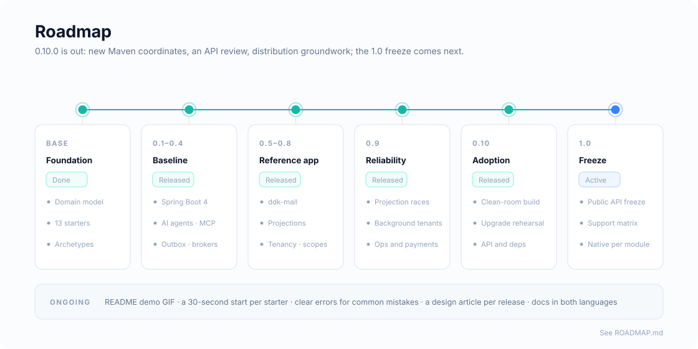

# DDK Roadmap

[简体中文](./ROADMAP.zh-CN.md)

<p align="center">
  
</p>

This roadmap has four parts: **what is supported today** and how well each part is verified, **what the next release contains**, **what comes after it**, and a **pool of candidates** without order or dates. What earlier releases delivered is summarized under [History](#history) and listed in full in the [changelog](./CHANGELOG.md).

## Positioning

> **DDK makes DDD executable in Spring Boot projects: domain building blocks out of the box, architecture rules enforced in CI, middleware integrated through domain semantics, and the same guardrails for humans and AI coding agents.**

Three observations decide what DDK does and does not do:

1. **Spring already covers modularity and event registries.** Spring Modulith 2 verifies module boundaries and ships a persistent event publication registry; jMolecules provides DDD concept annotations. DDK interoperates with them instead of rebuilding them.
2. **The mainstream stack in China lacks a DDD layer.** MyBatis-Plus, Redis, RocketMQ, Seata, XXL-Job and Nacos are an extremely common combination, yet almost nothing ties them to aggregates, repositories and domain events. This is where DDK is most distinctive.
3. **AI coding agents need executable architecture constraints.** Tools like Claude Code and Codex write code fast and blur layers just as fast. A project with a predictable structure and rules that fail tests is naturally better suited to agent collaboration. DDK already has ArchGuard; turning it into the agent's feedback loop is the obvious next step.

```text
             ┌───────────────────────────── your business code ─────────────────────┐
             │   adapter  ──►  application  ──►  domain  ◄──  infrastructure        │
             └──────┬───────────────┬──────────────┬───────────────┬────────────────┘
                    │               │              │               │
  Guardrails   ArchGuard rules · AGENTS.md / Skills · generated projects ship architecture tests
  Domain       ddk-core: aggregates · value objects · domain events · specifications · repositories
  Reliability  outbox · idempotency · distributed locks · rate limits   ← keyed by aggregate / command
  Integration  MyBatis-Plus · Redis · RocketMQ/Kafka · ShedLock · Elasticsearch · Seata
  AI           Spring AI · MCP: application services as tools, under the same validation and permissions
  Platform     Spring Boot 4 · Jackson 3 · JSpecify · virtual threads · OpenTelemetry
```

### Integration principles

Middleware integration is the fastest way to turn a toolkit into a kitchen sink. DDK only integrates where **domain semantics add value**:

| A thin wrapper (avoid) | What DDK should provide |
|---|---|
| A `RedisUtil` that forwards every `RedisTemplate` method | `@AggregateLock` keyed by aggregate ID, with lock failures mapped to business errors |
| Another `send()` wrapper around RocketMQ | Domain events delivered reliably through an outbox to RocketMQ / Kafka, with idempotent consumers |
| Registering the Elasticsearch client as a bean | Read models refreshed from the write model after commit, rebuildable on demand |
| Re-wrapping XXL-Job annotations | Scheduled jobs that only call application services, enforced by architecture rules |

Every starter must meet the same **starter contract** before it is merged:

- Configuration lives under `ddk.*`, and risky features are disabled by default
- User-defined beans win (`@ConditionalOnMissingBean`)
- `ApplicationContextRunner` wiring tests, plus Testcontainers integration tests for external middleware
- A dedicated docs page: what it does, where it does not fit, known issues
- Used by at least one example or archetype

## Support status

DDK has one version number, but its modules are not equally proven. Each one has one of these levels:

| Level | Meaning |
|---|---|
| **Verified** | Integration tests against the real database or middleware run in CI on every change |
| **In-process verified** | Tested end to end inside the JVM (MockMvc, an MCP client, H2); there is no external system to test against, or the external part is checked by hand |
| **Wiring only** | Auto-configuration and unit tests; the runtime behavior against the real system is not exercised |
| **Development only** | Meant for local runs and tests, never for production |

| Module | Level | Verified against | Known limits |
|---|---|---|---|
| `ddk-core` | Verified | Pure Java; domain purity checked by ArchUnit | |
| `ddk-mybatis` | Verified | H2; MySQL 8.4 through `ddk-mybatis-starter` and `ddk-mall` | |
| `ddk-test` | Verified | Testcontainers presets for MySQL, Redis, RocketMQ, Elasticsearch | |
| Web starter | In-process verified | MockMvc | |
| MyBatis starter (audit, tenancy, data scope) | Verified | H2, MySQL 8.4 | |
| Redis starter | Verified | Redis, through the cache starter's integration tests | |
| Cache starter | Verified | Redis | |
| Concurrency starter | Verified | Redis | Idempotency is per TTL window, not exactly-once |
| Job starter | Verified | Redis lock; in-process lock | |
| Event starter | Verified | H2, PostgreSQL 17, RocketMQ, Spring Modulith JDBC registry | Kafka, AMQP and JMS go through Modulith's own modules and are not tested by DDK; local delivery is development only |
| Projection starter | Verified | H2, MySQL 8.4, PostgreSQL 17; Elasticsearch through `ddk-mall` | No Elasticsearch-specific helpers |
| MCP starter | In-process verified | A real MCP client over streamable HTTP | Synchronous server only; authorization is the application's |
| ArchGuard starter | Verified | ArchUnit fixtures for every rule | |
| Tracer starter | In-process verified | Trace context across HTTP and messages | Export to a tracing backend is checked by hand only |
| DB starter (several data sources) | Wiring only | H2 | Outbox, inbox and pending tables are atomic only with the data source of the business transaction |
| Seata starter | Wiring only | | Seata's runtime is not verified on Spring Boot 4 |
| Archetypes (three and four layers) | Verified | Generated projects are built and tested in CI | |
| `ddk-mall` | Verified, as a reference | MySQL, Redis, RocketMQ, Elasticsearch | Simulated payment channel; demo users in the `secure` profile |

## Next release: 0.9

0.9 carries the fixes and production-path work from the October 2026 review. All of it is merged; the release is pending.

- **Reliability**: projections converge when refreshes overlap; `@Idempotent` releases only its own registration; idempotent event consumers have a stable identity; the four-layer rule keeps application services off infrastructure; the installer installs the version that was asked for
- **Production path**: tenants carried by projection marks and integration events, system operators for background work; projection and event operations (failure lists, retries, metrics, scheduled maintenance); event contracts by type and version; payment recovery and a `secure` profile in `ddk-mall`
- **Upgrading**: CI compares the public API with the last release (japicmp), and breaking changes and migrations are collected in the [upgrade guide](https://poppycoder.netlify.app/ddk/upgrade)

## After 0.9: adoption and upgrades

**Goal: someone outside this repository can use DDK and move between versions without reading its source.**

- [ ] Clean-room build: a project outside the repository with an empty local Maven repository, using only the installer and the BOM; both archetypes generated and verified
- [ ] Upgrade rehearsal: a 0.8 project upgraded to 0.9 with nothing but the upgrade guide
- [ ] Review the public API and each starter's transitive dependencies: what is required, what is optional, what leaks into applications
- [ ] Distribution: decide Maven coordinates (`io.github.poppycoderr`), signing and provenance, so publishing to a standard Maven repository becomes a decision rather than a project. No longer waits for stars: friction in adoption is what prevents feedback
- [ ] CI split into stages that are easier to read (unit and wiring, real middleware, generated projects, API compatibility) without letting required tests skip silently; check that the BOM and the parent pom agree on versions

## 1.0: freeze

**Goal: freeze only what has been verified.**

- [ ] Freeze the verified core API and the support matrix above; strict semantic versioning from then on
- [ ] Context semantics on virtual threads: operator, trace, lock ordering, cancellation and pool reuse, not only "it starts"
- [ ] GraalVM support declared per module, starting with a minimal example, instead of all starters at once
- [ ] Known limits, rollback paths and maintenance responsibility written down

## Candidate pool

No order and no dates. An item moves into a release when there is a concrete need for it.

| Candidate | Notes |
|---|---|
| Nacos (configuration) and Sentinel (traffic control) | Both come through Spring Cloud Alibaba, which follows Spring Cloud, which follows Spring Boot. On 2026-10-12 there was no GA Spring Cloud release for Spring Boot 4.1. Check the upstream compatibility range again when starting, and test the combination |
| S3-compatible object storage | File references as value objects; the domain never touches the SDK |
| Elasticsearch helpers for projections | Index management and alias switching on rebuild |
| One-command project creation and an online generator | `jbang ddk@poppycoderr new my-app`, a Spring Initializr-like page; after the installer's version selection has settled |
| Preset Grafana dashboards for `ddk-mall` | On top of the projection, event and cache metrics |
| A 30-second start on every starter's page, clearer errors for common mistakes | Documentation work |
| Community | Issue and PR templates, `good first issue` labels, Discussions, a design article per release |

## History

| Release | Theme |
|---|---|
| Foundation | Domain model primitives, generic repository, starters under `ddk.*`, archetypes, CI with coverage gates |
| 0.1 | Spring Boot 4.1 baseline, JSpecify nullness, first GitHub Release and the installer |
| 0.2 | AI collaboration: `AGENTS.md`, Claude Code Skills, machine-readable ArchGuard reports, the MCP starter |
| 0.3 | Reliable domain events: outbox through Spring Modulith, RocketMQ delivery, idempotent consumers, event contracts |
| 0.4 | Middleware: aggregate locks, idempotency and rate limits on Redisson, ShedLock jobs, Flyway in archetypes, documented error contracts, `ddk-test` |
| 0.5 | `OperatorContext`, audit fields, multi-tenancy that fails closed |
| 0.6 | `ddk-mall` reference application, event consumers, traces across messages |
| 0.7 | Fail-fast checks for locks and events inside or outside transactions, in-process job locks |
| 0.8 | Projections, row-level data scope |

## Non-goals

- No home-grown ORM, message broker or service registry; only integrations with domain meaning
- No reimplementation of what Spring Modulith already provides; interoperate first
- No event sourcing: domain events are for integration and decoupling, not for rebuilding state
- No low-code or code generation platform: only skeletons are generated, and business code is written by people (or agents) within the guardrails
- No AI features for the sake of hype: AI capabilities go through application services, under the same validation, permissions and architecture rules
