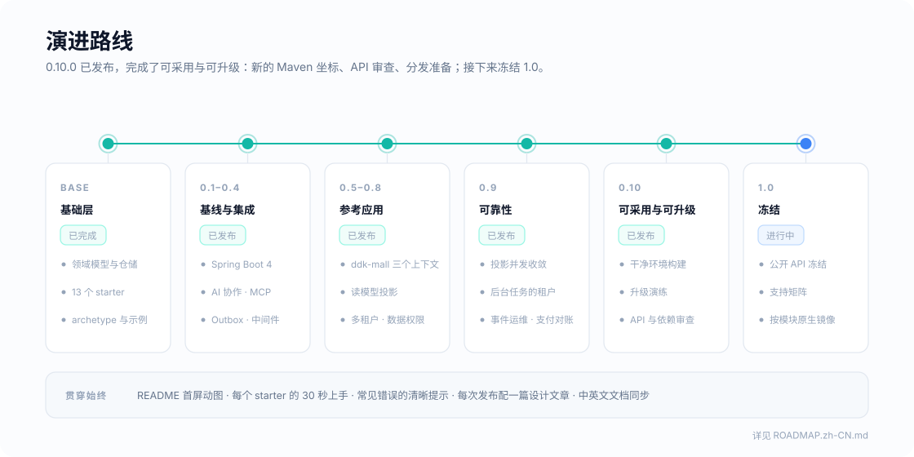

# DDK 路线图

[English](./ROADMAP.md)

<p align="center">
  
</p>

这份路线图分四部分：**现在支持什么**、各部分验证到什么程度；**下一个版本包含什么**；**之后做什么**；以及没有顺序和日期的**候选池**。已发布版本做了什么，概要见[历史](#历史)，完整内容见 [CHANGELOG](./CHANGELOG.md)。

## 定位

> **DDK 让 Spring Boot 项目里的 DDD 可执行：领域模型开箱即用，架构规则跑在 CI 里，常用中间件按领域语义接入，人和 AI 编码代理都在同一套护栏里写代码。**

三个判断决定了 DDK 做什么、不做什么：

1. **Spring 官方已经覆盖了模块化与事件注册表。** Spring Modulith 2 提供了模块边界校验和持久化的事件发布注册表，jMolecules 提供了 DDD 概念注解。DDK 不重复造这些轮子，而是和它们互通。
2. **国内主流技术栈缺少 DDD 落地层。** MyBatis-Plus、Redis、RocketMQ、Seata、XXL-Job、Nacos 这套组合非常普遍，但几乎没有项目把它们和聚合、仓储、领域事件串成一套约定。这是 DDK 最有差异化的位置。
3. **AI 编码代理需要可执行的架构约束。** Claude Code、Codex 这类工具写代码很快，也很容易把分层写乱。结构可预测、规则能在测试里报错的项目，天然更适合交给代理协作。DDK 已经有 ArchGuard，把它做成代理的反馈回路是顺势而为。

```text
             ┌──────────────────────────── 你的业务代码 ────────────────────────────┐
             │   adapter  ──►  application  ──►  domain  ◄──  infrastructure        │
             └──────┬───────────────┬──────────────┬───────────────┬────────────────┘
                    │               │              │               │
  护栏        ArchGuard 规则 · AGENTS.md / Skills · 生成项目即带架构测试
  领域        ddk-core：聚合 · 值对象 · 领域事件 · 规约 · 仓储契约
  可靠性      Outbox · 幂等 · 分布式锁 · 限流          ← 按聚合 / 命令语义封装
  集成        MyBatis-Plus · Redis · RocketMQ/Kafka · ShedLock · Elasticsearch · Seata
  AI          Spring AI · MCP：应用服务即工具，受同一套校验与权限约束
  平台        Spring Boot 4 · Jackson 3 · JSpecify · 虚拟线程 · OpenTelemetry
```

### 集成原则

中间件集成最容易把项目做成「大而全」。DDK 只在**领域语义能带来价值**的地方接入：

| 只做薄封装的反例 | DDK 应该提供的 |
|---|---|
| `RedisUtil` 逐个方法转发 `RedisTemplate` | 以聚合 ID 为粒度的 `@AggregateLock`，锁失败映射成业务异常 |
| 给 RocketMQ 再包一层 `send()` | 领域事件经 Outbox 可靠投递到 RocketMQ / Kafka，消费端自带幂等 |
| 把 Elasticsearch 客户端注册成 Bean | 提交后从写模型刷新、可以随时重建的读模型 |
| 再封装一遍 XXL-Job 注解 | 定时任务只调用应用服务，被架构规则约束，不直接碰仓储 |

每个 starter 在合并前都要满足同一份 **Starter 契约**：

- 配置统一在 `ddk.*` 前缀下，有风险的能力默认关闭
- 使用方自定义 Bean 优先（`@ConditionalOnMissingBean`）
- `ApplicationContextRunner` 装配测试；涉及外部中间件的，用 Testcontainers 跑真实集成测试
- 文档站有独立页面：能做什么、不适用的场景、已知问题
- 至少被一个示例或 archetype 使用

## 支持状态

DDK 只有一个版本号，但各模块经受的验证并不一样。每个模块属于下面一个级别：

| 级别 | 含义 |
|---|---|
| **已验证** | 每次改动都在 CI 里对真实的数据库或中间件跑集成测试 |
| **进程内验证** | 在 JVM 内端到端测试（MockMvc、MCP 客户端、H2）；没有外部系统可测，或者外部部分只做过手工验证 |
| **仅装配** | 只有自动配置和单元测试，没有对真实系统验证运行时行为 |
| **仅开发** | 只用于本地运行和测试，不能用于生产 |

| 模块 | 级别 | 验证环境 | 已知限制 |
|---|---|---|---|
| `ddk-core` | 已验证 | 纯 Java；领域纯度由 ArchUnit 检查 | |
| `ddk-mybatis` | 已验证 | H2；经 `ddk-mybatis-starter` 和 `ddk-mall` 覆盖 MySQL 8.4 | |
| `ddk-test` | 已验证 | MySQL、Redis、RocketMQ、Elasticsearch 的 Testcontainers 预设 | |
| Web starter | 进程内验证 | MockMvc | |
| MyBatis starter（审计、多租户、数据权限） | 已验证 | H2、MySQL 8.4 | |
| Redis starter | 已验证 | Redis，经缓存 starter 的集成测试 | |
| Cache starter | 已验证 | Redis | |
| Concurrency starter | 已验证 | Redis | 防重复提交按 TTL 窗口生效，不是恰好一次 |
| Job starter | 已验证 | Redis 锁；进程内锁 | |
| Event starter | 已验证 | H2、PostgreSQL 17、RocketMQ、Spring Modulith 的 JDBC 发布记录 | Kafka、AMQP、JMS 走 Modulith 自己的模块，DDK 没有测试；进程内转发仅开发 |
| Projection starter | 已验证 | H2、MySQL 8.4、PostgreSQL 17；Elasticsearch 经 `ddk-mall` | 没有 Elasticsearch 专用的辅助功能 |
| MCP starter | 进程内验证 | 真实 MCP 客户端，streamable HTTP | 只支持同步 server；授权由应用负责 |
| ArchGuard starter | 已验证 | 每条规则都有 ArchUnit 正反例 | |
| Tracer starter | 进程内验证 | 跨 HTTP 和消息的链路上下文 | 导出到追踪后端只做过手工验证 |
| DB starter（多数据源） | 仅装配 | H2 | 发件箱、去重表、待刷新表只有和业务事务用同一个数据源时才是原子的 |
| Seata starter | 仅装配 | | Seata 的运行时没有在 Spring Boot 4 上验证 |
| Archetype（三层、四层） | 已验证 | 生成的项目在 CI 里构建和测试 | |
| `ddk-mall` | 已验证，作为参考实现 | MySQL、Redis、RocketMQ、Elasticsearch | 支付渠道是模拟的；`secure` profile 用演示用户 |

## 最新版本：0.9

[0.9.0](https://github.com/poppycoderr/domain-driven-kit/releases/tag/v0.9.0) 于 2026-10-21 发布，收录 2026 年 10 月评审提出的修复和生产路径工作。

- **可靠性**：投影在刷新重叠时也能收敛；`@Idempotent` 只释放自己的登记；去重的事件消费方有稳定身份；四层规则不再允许应用服务直接引用基础设施；安装脚本装的是指定的版本
- **生产路径**：投影标记和集成事件携带租户，后台工作以系统操作者身份执行；投影和事件的运维（失败列表、立即重试、指标、定时维护）；按类型和版本声明的事件契约；`ddk-mall` 的支付对账和 `secure` profile
- **升级**：CI 用 japicmp 对比上一个发布版本的公开 API；破坏性变更和迁移步骤汇总在[升级指南](https://poppycoder.netlify.app/ddk/upgrade)

## 0.9 之后：可采用与可升级

**目标：仓库之外的人不读源码，也能用上 DDK、在版本之间升级。**

- [x] 干净环境构建：在仓库之外、本地 Maven 仓库为空的项目里，只靠安装脚本和 BOM，生成并验证两种 archetype
- [x] 升级演练：一个 0.8 项目只看升级指南升级到 0.9，演练发现的缺口已补进指南
- [x] 审查公开 API 和每个 starter 的传递依赖：哪些必需、哪些可选、哪些会泄漏到应用里
- [ ] 分发准备：定下 Maven 坐标（`io.github.poppycoderr`）、签名和来源证明，让发布到标准 Maven 仓库变成一个决定，而不是一个项目。不再以 star 数为前提：采用门槛高本身就妨碍了反馈
- [x] CI 分成更易读的阶段（单元与装配、真实中间件、生成项目、API 兼容），但不能让必需的测试悄悄不跑；检查 BOM 和父 pom 的版本一致

## 1.0：冻结

**目标：只冻结经过验证的部分。**

- [ ] 冻结经过验证的核心 API 和上面的支持矩阵，此后严格遵守语义化版本
- [ ] 虚拟线程上的上下文语义：操作者、链路、加锁顺序、取消、线程池复用，而不只是「能启动」
- [ ] GraalVM 按模块声明支持，从一个最小示例开始，不要求所有 starter 一起支持
- [ ] 写清已知限制、回滚路径和维护责任

## 候选池

没有顺序，也没有日期。有了具体需要，才把一项放进某个版本。

| 候选 | 说明 |
|---|---|
| Nacos（配置）与 Sentinel（流量控制） | 两者都经由 Spring Cloud Alibaba，它跟随 Spring Cloud，Spring Cloud 又跟随 Spring Boot。2026-10-12 查到还没有面向 Spring Boot 4.1 的 Spring Cloud 正式版。开始做时重新核对上游兼容范围，并做组合测试 |
| S3 兼容的对象存储 | 文件引用作为值对象，领域层不接触 SDK |
| 投影的 Elasticsearch 辅助功能 | 索引管理、重建时切换别名 |
| 一行命令创建项目、在线项目生成器 | `jbang ddk@poppycoderr new my-app`，类似 Spring Initializr 的页面；等安装脚本的版本选择稳定之后 |
| `ddk-mall` 的预置 Grafana 看板 | 基于投影、事件和缓存的指标 |
| 每个 starter 页面的 30 秒上手、常见错误的清晰提示 | 文档工作 |
| 社区 | Issue 和 PR 模板、`good first issue` 标签、Discussions、每次发布配一篇设计文章 |

## 历史

| 版本 | 主题 |
|---|---|
| 基础层 | 领域模型基类、通用仓储、统一在 `ddk.*` 下的 starter、archetype、带覆盖率门槛的 CI |
| 0.1 | Spring Boot 4.1 基线、JSpecify 空安全、首个 GitHub Release 和安装脚本 |
| 0.2 | AI 协作：`AGENTS.md`、Claude Code Skills、代理可读的 ArchGuard 报告、MCP starter |
| 0.3 | 可靠领域事件：经 Spring Modulith 的发件箱、RocketMQ 投递、幂等消费、事件契约 |
| 0.4 | 中间件：基于 Redisson 的聚合锁、防重复提交和限流，ShedLock 定时任务，archetype 里的 Flyway，错误契约文档，`ddk-test` |
| 0.5 | `OperatorContext`、审计字段、取不到租户就失败的多租户 |
| 0.6 | `ddk-mall` 参考应用、事件消费方、跨消息的链路 |
| 0.7 | 锁和事件在事务内外用错时直接报错，进程内的任务锁 |
| 0.8 | 读模型投影、行级数据权限 |
| 0.9 | 2026 年 10 月评审的可靠性修复、后台工作的租户、投影与事件运维、`ddk-mall` 的支付对账与 secure profile、升级指南 |

## 明确不做

- 不自研 ORM、消息中间件或注册中心，只做与领域语义相关的集成
- 不重复实现 Spring Modulith 已经提供的能力，优先互通
- 不做事件溯源：领域事件用于集成与解耦，不用于重建状态
- 不做低代码或代码生成平台：生成的只是骨架，业务代码由人（或代理）在护栏内编写
- 不为了追热点堆砌 AI 功能：AI 能力必须经过应用服务，受同样的校验、权限与架构规则约束
