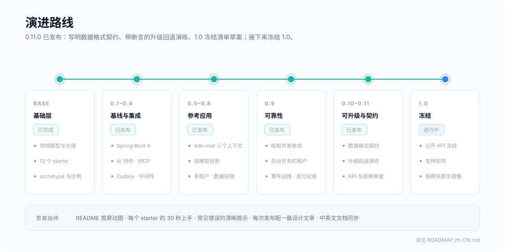

# DDK 路线图

[English](./ROADMAP.md)

<p align="center">
  
</p>

这份路线图分四部分：**现在支持什么**、各部分验证到什么程度；**下一个版本包含什么**；**之后做什么**；以及没有顺序和日期的**候选池**。已发布版本做了什么，概要见[历史](#历史)，完整内容见 [CHANGELOG](./CHANGELOG.md)。

## 定位

> **DDK 让 Spring Boot 项目里的 DDD 可执行：领域模型开箱即用，架构规则跑在 CI 里，常用中间件按领域语义接入，人和 AI 编码代理都在同一套护栏里写代码。**

三个判断决定了 DDK 做什么、不做什么：

1. **Spring 官方已经覆盖了模块化与事件注册表。** Spring Modulith 2 提供了模块边界校验和持久化的事件发布注册表，jMolecules 提供了 DDD 概念注解。DDK 不重复造这些轮子，而是和它们互通。
2. **国内主流技术栈缺少 DDD 落地层。** MyBatis-Plus、Redis、RocketMQ、Seata、XXL-Job、Nacos 这套组合非常普遍，但几乎没有项目把它们和聚合、仓储、领域事件串成一套约定。这是 DDK 最有差异化的位置。
3. **AI 编码代理需要可执行的架构约束。** Claude Code、Codex 这类工具写代码很快，也很容易把分层写乱。结构可预测、规则能在测试里报错的项目，天然更适合交给代理协作。DDK 已经有 ArchGuard，把它做成代理的反馈回路是顺势而为。

```text
             ┌──────────────────────────── 你的业务代码 ────────────────────────────┐
             │   adapter  ──►  application  ──►  domain  ◄──  infrastructure        │
             └──────┬───────────────┬──────────────┬───────────────┬────────────────┘
                    │               │              │               │
  护栏        ArchGuard 规则 · AGENTS.md / Skills · 生成项目即带架构测试
  领域        ddk-core：聚合 · 值对象 · 领域事件 · 规约 · 仓储契约
  可靠性      Outbox · 幂等 · 分布式锁 · 限流          ← 按聚合 / 命令语义封装
  集成        MyBatis-Plus · Redis · RocketMQ/Kafka · ShedLock · Elasticsearch · Seata
  AI          Spring AI · MCP：应用服务即工具，受同一套校验与权限约束
  平台        Spring Boot 4 · Jackson 3 · JSpecify · 虚拟线程 · OpenTelemetry
```

### 集成原则

中间件集成最容易把项目做成「大而全」。DDK 只在**领域语义能带来价值**的地方接入：

| 只做薄封装的反例 | DDK 应该提供的 |
|---|---|
| `RedisUtil` 逐个方法转发 `RedisTemplate` | 以聚合 ID 为粒度的 `@AggregateLock`，锁失败映射成业务异常 |
| 给 RocketMQ 再包一层 `send()` | 领域事件经 Outbox 可靠投递到 RocketMQ / Kafka，消费端自带幂等 |
| 把 Elasticsearch 客户端注册成 Bean | 提交后从写模型刷新、可以随时重建的读模型 |
| 再封装一遍 XXL-Job 注解 | 定时任务只调用应用服务，被架构规则约束，不直接碰仓储 |

每个 starter 在合并前都要满足同一份 **Starter 契约**：

- 配置统一在 `ddk.*` 前缀下，有风险的能力默认关闭
- 使用方自定义 Bean 优先（`@ConditionalOnMissingBean`）
- `ApplicationContextRunner` 装配测试；涉及外部中间件的，用 Testcontainers 跑真实集成测试
- 文档站有独立页面：能做什么、不适用的场景、已知问题
- 至少被一个示例或 archetype 使用

## 支持状态

DDK 只有一个版本号，但各模块经受的验证并不一样。每个模块属于下面一个级别：

| 级别 | 含义 |
|---|---|
| **已验证** | 每次改动都在 CI 里对真实的数据库或中间件跑集成测试 |
| **进程内验证** | 在 JVM 内端到端测试（MockMvc、MCP 客户端、H2）；没有外部系统可测，或者外部部分只做过手工验证 |
| **仅装配** | 只有自动配置和单元测试，没有对真实系统验证运行时行为 |
| **仅开发** | 只用于本地运行和测试，不能用于生产 |

| 模块 | 级别 | 验证环境 | 已知限制 |
|---|---|---|---|
| `ddk-core` | 已验证 | 纯 Java；领域纯度由 ArchUnit 检查 | |
| `ddk-mybatis` | 已验证 | H2；经 `ddk-mybatis-starter` 和 `ddk-mall` 覆盖 MySQL 8.4 | |
| `ddk-test` | 已验证 | MySQL、Redis、RocketMQ、Elasticsearch 的 Testcontainers 预设 | |
| Web starter | 进程内验证 | MockMvc | |
| MyBatis starter（审计、多租户、数据权限） | 已验证 | H2、MySQL 8.4 | |
| Redis starter | 已验证 | Redis，经缓存 starter 的集成测试 | |
| Cache starter | 已验证 | Redis | |
| Concurrency starter | 已验证 | Redis | 防重复提交按 TTL 窗口生效，不是恰好一次 |
| Job starter | 已验证 | Redis 锁；进程内锁 | |
| Event starter | 已验证 | H2、PostgreSQL 17、RocketMQ、Spring Modulith 的 JDBC 发布记录 | Kafka、AMQP、JMS 走 Modulith 自己的模块，DDK 没有测试；进程内转发仅开发 |
| Projection starter | 已验证 | H2、MySQL 8.4、PostgreSQL 17；Elasticsearch 经 `ddk-mall` | 没有 Elasticsearch 专用的辅助功能 |
| MCP starter | 进程内验证 | 真实 MCP 客户端，streamable HTTP | 只支持同步 server；授权由应用负责 |
| ArchGuard starter | 已验证 | 每条规则都有 ArchUnit 正反例 | |
| Tracer starter | 进程内验证 | 跨 HTTP 和消息的链路上下文 | 导出到追踪后端只做过手工验证 |
| DB starter（多数据源） | 已验证 | H2；PostgreSQL 17 和 MySQL 8.4 同时作为两个数据源 | 发件箱、去重表、待刷新表只有和业务事务用同一个数据源时才是原子的 |
| Seata starter | 仅装配 | | Seata 的运行时没有在 Spring Boot 4 上验证 |
| Archetype（三层、四层） | 已验证 | 生成的项目在 CI 里构建和测试 | |
| `ddk-mall` | 已验证，作为参考实现 | MySQL、Redis、RocketMQ、Elasticsearch | 支付渠道是模拟的；`secure` profile 用演示用户 |

## 最新版本：0.11

[0.11.0](https://github.com/poppycoderr/domain-driven-kit/releases/tag/v0.11.0) 于 2026-11-10 发布。**目标：把 1.0 要冻结的契约定下来，补上 2026 年 10 月冻结评审发现的可靠性缺口，并在一个真实项目上验证升级和回退。** 0.11 不新增 starter，也不扩大任何支持声明；具体变化见 [CHANGELOG](./CHANGELOG.md) 和[升级指南](https://domaindrivenkit.com/ddk/upgrade)。

契约：

- [x] [COMPATIBILITY.zh-CN.md](./COMPATIBILITY.zh-CN.md) 列出滚动升级依赖的数据和传输格式，不只是 key 名和表名：Outbox 记录、消息头的取值、去重消费方的身份、Redis 值、缓存失效消息
- [x] 同时写明每种版本可以做哪些平台变化：1.x 最低 Java 21、Spring Boot 4 系列、DDK 固定版本的库，以及出现在 DDK API 里的库类型
- [x] 已发布的 0.10.0 写下的数据，当前代码能读，并且按同样的方式写回（[`compat/`](./compat/README.md)）：事件消息、Outbox 记录、两张表、Redis 值、缓存失效消息、锁 key
- [x] 两项行为变化列在 **Breaking** 下并给出迁移步骤：`@Idempotent` 和 `@RateLimit` 的默认 scope 写全参数类型；等锁时被中断报 `CancellationException`

可靠性：

- [x] 失去领取的 worker 写入后又失败时，投影也能收敛
- [x] 应用自己的 `CacheInvalidationPublisher` 可以替换 Redis 发布器
- [x] 参数简单类名相同的重载不再共用防重复提交登记和限流额度
- [x] 事件维护在两个实例、真实 Redis 锁下测试
- [x] GraalVM：CI 把 `ddk-example-user` 构建成原生镜像并做冒烟测试；支持情况按模块写在 [SUPPORT.zh-CN.md](./SUPPORT.zh-CN.md#graalvm-原生镜像)

验收：

- [x] 防重复提交和限流 key 的跨版本 fixture，这是 0.11 唯一改变的持久格式：key 的结构不变，默认 scope 按 **Breaking** 里写的改变
- [x] 升级与回退演练：用 Maven 中央仓库的 0.10.0 生成一个项目，升级到 0.11 再回退，0.10 和 0.11 的实例共用一个 MySQL 和一个 Redis 同时运行，检查 Redis key、两个版本同时运行期间各用一套的登记和额度、取消，以及两个版本共用的表和 Outbox 记录。步骤和结果见[升级指南](https://domaindrivenkit.com/ddk/upgrade)
- [x] 1.0 冻结清单草案：冻结什么、哪些保持实验性、哪些还没定，见 [COMPATIBILITY.zh-CN.md](./COMPATIBILITY.zh-CN.md#10-冻结清单草案)
- [x] 候选版本通过 Java 21 和 25、生成项目、API 比较和原生镜像任务。发布之后把它的 fixture 加到 `compat/`，`api.baseline.version` 改为 0.11.0

不在 0.11 里：

- DB 和 Seata starter 保持实验性，只验证到装配层面
- 原生镜像的支持范围保持在 CI 验证过的模块，不声明其他模块
- 事件发布指标在 `event_publication` 上按状态计数，而这张表的 `status` 没有索引，每次采集都扫表。事件 starter 的 README 给出了实测开销和应对办法；降低开销是之后的性能项
- 消费端去重不变：它依赖跨租户唯一的事件 ID，以及来自消费方信任的来源的消息。租户消息头没有签名

## 1.0：冻结

**目标：只冻结经过验证的部分。**

- [ ] 冻结经过验证的核心 API 和上面的支持矩阵，此后严格遵守语义化版本。冻结哪些、哪些保持实验性、哪些还要决定，见[冻结清单](./COMPATIBILITY.zh-CN.md#10-冻结清单草案)
- [x] 虚拟线程上的上下文语义：操作者、链路、加锁顺序、取消、线程池复用，而不只是「能启动」
- [x] GraalVM 按模块声明支持，从一个最小示例开始，不要求所有 starter 一起支持：CI 用 `ddk-example-user` 验证，依赖 Redis 的 starter、投影和发布登记用 `ddk-example-inventory` 验证，清单见 [SUPPORT.zh-CN.md](./SUPPORT.zh-CN.md#graalvm-原生镜像)
- [x] 写清已知限制、回滚路径和维护责任：[SUPPORT.zh-CN.md](./SUPPORT.zh-CN.md)，以及升级指南里每个版本的回退一节

## 候选池

没有顺序，也没有日期。有了具体需要，才把一项放进某个版本。

| 候选 | 说明 |
|---|---|
| Nacos（配置）与 Sentinel（流量控制） | 两者都经由 Spring Cloud Alibaba，它跟随 Spring Cloud，Spring Cloud 又跟随 Spring Boot。2026-10-12 查到还没有面向 Spring Boot 4.1 的 Spring Cloud 正式版。开始做时重新核对上游兼容范围，并做组合测试 |
| S3 兼容的对象存储 | 文件引用作为值对象，领域层不接触 SDK |
| 降低事件发布指标的开销 | 每次采集都按状态对 `event_publication` 计数，会扫表；实测开销和应对办法见事件 starter 的 README。需要一种不依赖 Spring Modulith 表结构的做法 |
| 投影的 Elasticsearch 辅助功能 | 索引管理、重建时切换别名 |
| 一行命令创建项目、在线项目生成器 | `jbang ddk@poppycoderr new my-app`，类似 Spring Initializr 的页面；等安装脚本的版本选择稳定之后 |
| `ddk-mall` 的预置 Grafana 看板 | 基于投影、事件和缓存的指标 |
| 每个 starter 页面的 30 秒上手、常见错误的清晰提示 | 文档工作 |
| 社区 | Issue 和 PR 模板、`good first issue` 标签、Discussions、每次发布配一篇设计文章 |

## 历史

| 版本 | 主题 |
|---|---|
| 基础层 | 领域模型基类、通用仓储、统一在 `ddk.*` 下的 starter、archetype、带覆盖率门槛的 CI |
| 0.1 | Spring Boot 4.1 基线、JSpecify 空安全、首个 GitHub Release 和安装脚本 |
| 0.2 | AI 协作：`AGENTS.md`、Claude Code Skills、代理可读的 ArchGuard 报告、MCP starter |
| 0.3 | 可靠领域事件：经 Spring Modulith 的发件箱、RocketMQ 投递、幂等消费、事件契约 |
| 0.4 | 中间件：基于 Redisson 的聚合锁、防重复提交和限流，ShedLock 定时任务，archetype 里的 Flyway，错误契约文档，`ddk-test` |
| 0.5 | `OperatorContext`、审计字段、取不到租户就失败的多租户 |
| 0.6 | `ddk-mall` 参考应用、事件消费方、跨消息的链路 |
| 0.7 | 锁和事件在事务内外用错时直接报错，进程内的任务锁 |
| 0.8 | 读模型投影、行级数据权限 |
| 0.9 | 2026 年 10 月评审的可靠性修复、后台工作的租户、投影与事件运维、`ddk-mall` 的支付对账与 secure profile、升级指南 |
| 0.10 | 可采用与可升级：groupId 改为 `com.domaindrivenkit`、公开 API 与依赖审查、发布来源证明与中央仓库签名、CI 分阶段 |
| 0.11 | 冻结前的契约：COMPATIBILITY 里的数据与传输格式和平台政策、已发布数据的 fixture、带断言的升级与回退演练、1.0 冻结清单草案 |

## 明确不做

- 不自研 ORM、消息中间件或注册中心，只做与领域语义相关的集成
- 不重复实现 Spring Modulith 已经提供的能力，优先互通
- 不做事件溯源：领域事件用于集成与解耦，不用于重建状态
- 不做低代码或代码生成平台：生成的只是骨架，业务代码由人（或代理）在护栏内编写
- 不为了追热点堆砌 AI 功能：AI 能力必须经过应用服务，受同样的校验、权限与架构规则约束
